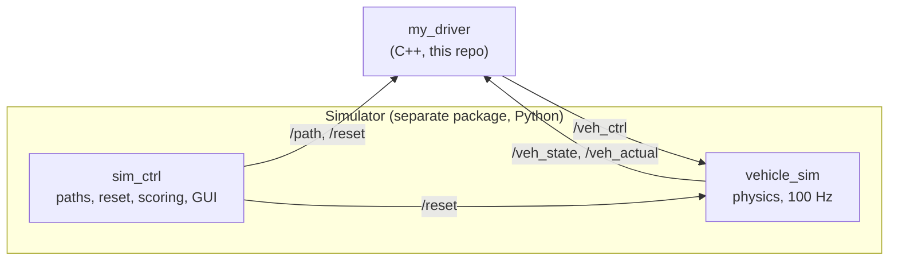
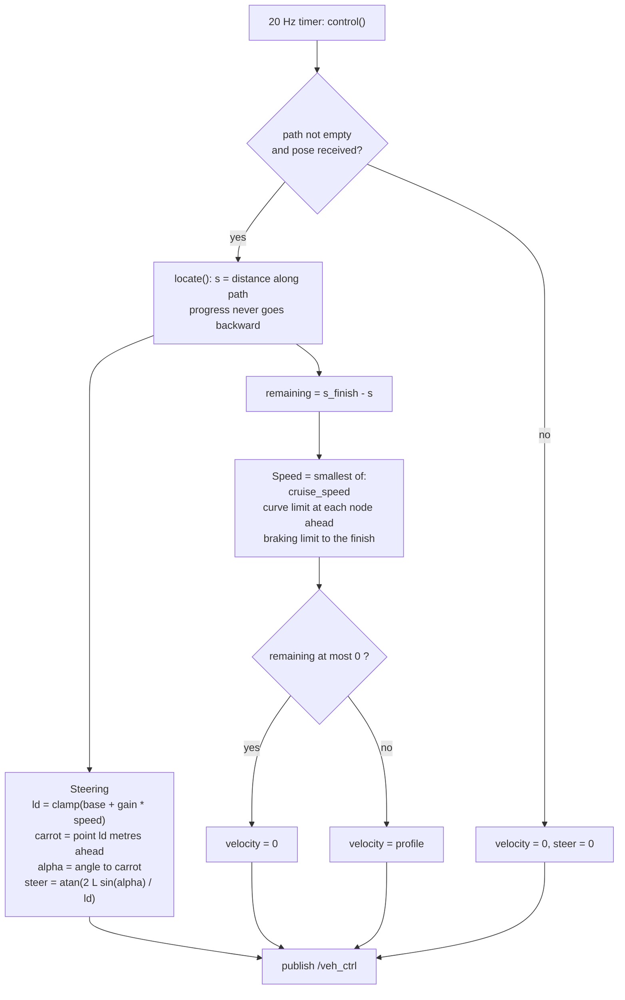

# Architecture of `my_driver`

How my C++ driver works: what it reads, what it decides, what it publishes, and why it is built this way.
Source: [my_driver/src/driver_node.cpp](my_driver/src/driver_node.cpp). Data flow between nodes: [FLOW.md](FLOW.md).

## 1. What it does

`my_driver` is one ROS 2 node (`Driver`). Every 50 ms it looks at the reference path and the car pose, chooses a
**speed** (m/s) and a **front-wheel steering angle** (rad), and publishes them on `/veh_ctrl`.
It follows the four simulator paths (`straight`, `wave`, `lane_change`, `circle`) and stops near the finish node.

Result with the final settings: **70.3 / 100** on the evaluation (demo driver: 62.3).

## 2. Where it sits



The driver and the simulator share **no code**. They only exchange ROS topics (details in [FLOW.md](FLOW.md)).

## 3. Code map

| Part of `driver_node.cpp` | Responsibility |
|---|---|
| `wrap()` | Keeps an angle in [-pi, pi] so heading errors never jump by 360 degrees |
| `Driver()` constructor | Declares the 8 ROS parameters, creates 4 subscriptions, 1 publisher and a 20 Hz timer |
| `on_path()` | Stores the path once and precomputes **arc length** `s_` and **curvature** `kappa_` for every node |
| `on_reset()` | Forgets the car pose, actual speed and progress; **keeps the path** |
| `locate()` | Finds the car's distance `s` along the path, searching **forward only** |
| `point_at()` | Returns the point a given distance `s` along the path (the pure-pursuit "carrot") |
| `control()` | The 20 Hz loop: steering + speed profile + publish |
| `main()` | Starts the node and spins it |

State kept between cycles: `pts_` (path points), `s_` (distance along path), `kappa_` (curvature), `finish_`
(finish node index), `progress_` (furthest node reached), `state_` (latest pose, empty until the first message),
`v_actual_` (real speed from `/veh_actual`).

## 4. One control cycle



The publish step is **outside** the decision: a command goes out every 50 ms even with no task, because the
simulator stops the car after 0.5 s of silence.

## 5. The algorithms

### 5.1 Where am I? (`locate`)
- Search the nearest node only in `[progress_, progress_ + 80]` (40 m ahead), then project the car onto the two
  neighbouring segments for a smooth distance `s`.
- `progress_ = max(progress_, index)` so progress only moves forward. This is what makes the **circle** work: its
  start and finish are the same coordinates, and a whole-path search would think the car finished at the start.

### 5.2 Steering: pure pursuit
```
ld    = clamp(lookahead_base + lookahead_gain * |v_actual|, lookahead_base, 15 m)
alpha = wrap( atan2(target_y - y, target_x - x) - yaw )
steer = clamp( atan2(2 * L * sin(alpha), ld), -0.6, 0.6 )          L = 2.5 m wheelbase
```
Longer lookahead at higher speed keeps the steering stable. A lookahead that is too short at speed made the car
leave the track (test set I: gain 0.15, score 47.0).

### 5.3 Speed profile
For every node `j` between the car and the finish (up to the braking horizon):
```
vc   = sqrt(lat_accel / kappa_j)                    fastest safe speed in that curve (no limit on a straight)
v    = min(v, sqrt(vc^2 + 2 * brake_decel * dist))  fastest speed now that can still slow to vc by node j
```
Then for the finish: `v = min(v, sqrt(2 * brake_decel * (remaining + stop_aim)))`.
`velocity = clamp(v, 0, cruise_speed)`, and `0` once `remaining <= 0`.

Why `stop_aim`: stopping within 5 m of the finish gives full stop points, so the plan aims a little *past* the line,
which keeps speed higher for longer.

## 6. Parameters (all are ROS parameters)

| Parameter | Code default | Final (best set N) | Meaning |
|---|---:|---:|---|
| `cruise_speed` | 12.0 | **25.0** | Speed ceiling [m/s] |
| `lat_accel` | 3.0 | **6.0** | Allowed `v^2 * kappa` in curves [m/s^2] |
| `brake_decel` | 3.5 | **5.9** | Braking the plan assumes (car limit is 6.0) [m/s^2] |
| `stop_aim` | 1.5 | **2.0** | Planned stop distance past the finish [m] |
| `lookahead_base` | 2.5 | 2.5 | Lookahead at standstill [m] |
| `lookahead_gain` | 0.4 | **0.25** | Extra lookahead per m/s [s] |
| `wheelbase` | 2.5 | 2.5 | Car geometry [m] |
| `max_steer` | 0.6 | 0.6 | Steering limit [rad] |

> **Note:** the defaults **inside the code are still the first-run values (score 66.6)**. The best settings are passed
> at launch (see section 9) or by `_SCRIPT/11.18.26 script/demo_best.bash`.

## 7. Design decisions

| Decision | Why |
|---|---|
| Timer-driven publishing, not message-driven | Commands must keep flowing at 20 Hz or the simulator zeroes the speed |
| Precompute `s_` and `kappa_` in `on_path` | The path arrives once; avoids recomputing 20 times a second |
| Forward-only progress | Prevents the circle's start/finish ambiguity and backward jumps |
| Min of three speed limits | Each limit protects against a different failure (curve, braking, finish) |
| Use `/veh_actual` for the lookahead | The real speed lags the command; the lookahead should follow the real speed |
| Keep the path on `/reset` | `/path` and `/reset` can arrive in either order |
| Everything tunable by parameter | Lets the sweep scripts test settings without rebuilding |

## 8. Limits and known issues

- **Average speed ceiling about 10 to 11 m/s** on a 60 m path: the car brakes at 6 m/s^2 at most.
- **Stop margin is thin:** the final set stops up to 4.75 m past the line; beyond 5 m each metre costs 5 points.
- **Noise:** the simulator adds actuator noise, so identical settings differ by about 0.5 points.
- **Short lookahead is unstable at speed** (set I failed 3 runs).
- Not used: feed-forward steering, pose prediction for latency, Stanley or MPC (ideas for improvement).

## 9. Build, run, test

```bash
cd ~/Desktop/pleng/NTHU-Racing_THRSimSimple
conda deactivate                      # Anaconda's Python breaks the ROS build
source /opt/ros/humble/setup.bash
colcon build --symlink-install --packages-select my_driver
source install/setup.bash

# run with the best settings
ros2 run my_driver driver --ros-args \
  -p cruise_speed:=25.0 -p lat_accel:=6.0 -p brake_decel:=5.9 \
  -p stop_aim:=2.0 -p lookahead_gain:=0.25

./run_sim.bash                        # simulator GUI (second terminal)
./evaluate.bash -n 3                  # official evaluation
"./11.18.26 script/demo_best.bash" eval         # live demo: driver + GUI evaluation in one command
./scripts/sweep4.bash                 # parameter sweep (headless)
```

## 10. Repo map

| Path | What it is |
|---|---|
| `my_driver/` | This driver (C++, `ament_cmake`) |
| `simulator/` | `thr_sim` (vehicle_sim, sim_ctrl, GUI) and `thr_sim_msgs` (message types) |
| `demo_driver/` | The Python baseline (62.3) |
| `_SCRIPT/11.18.26 script/` | Sweep scripts (`sweep*.bash`) and the demo launcher (`demo_best.bash`) |
| `_LOG/11.18.26 log and diagram/personal_log.md` | Step-by-step log, every experiment and its result |
| `ARCHITECTURE.md`, `FLOW.md` | These documents |
