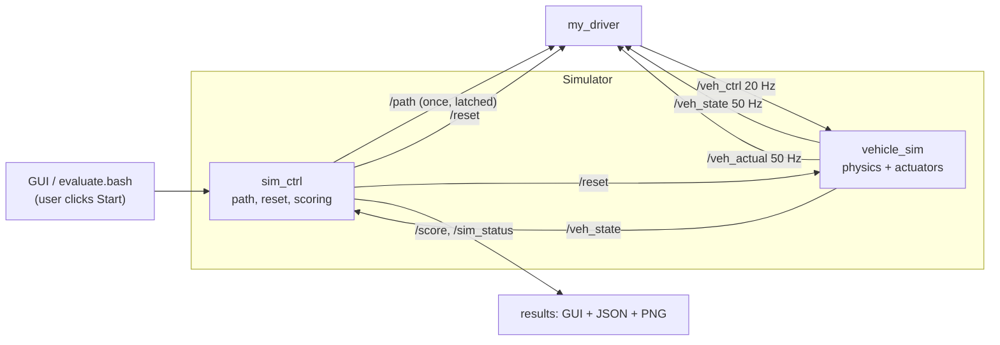
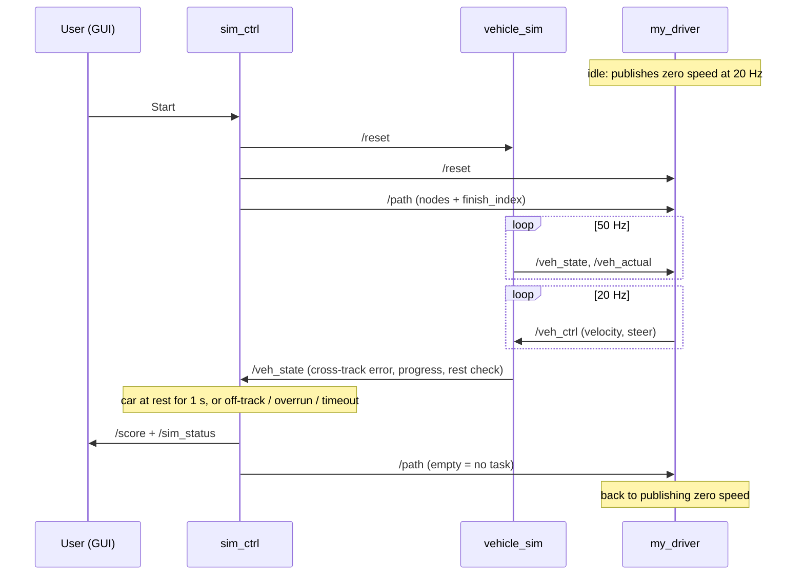
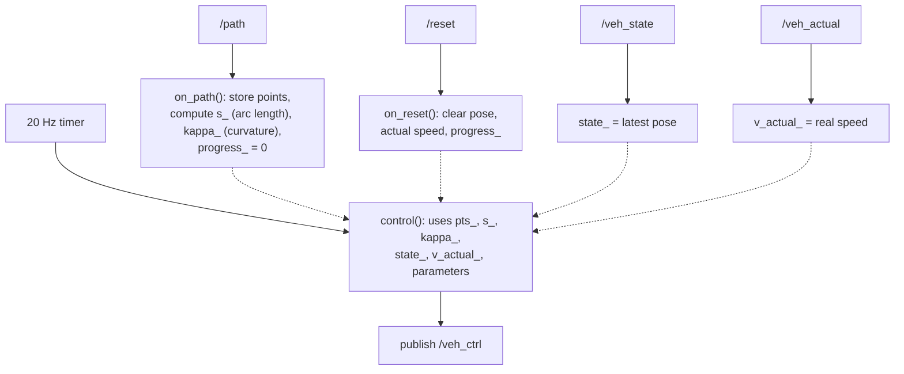
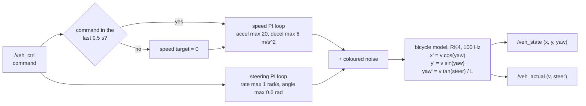
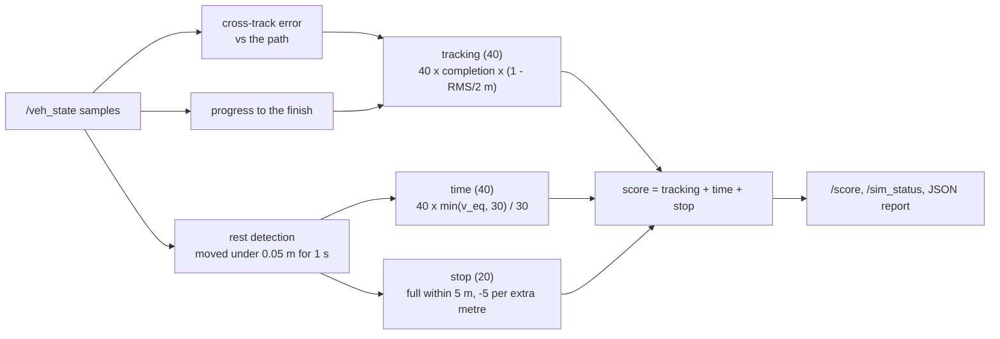
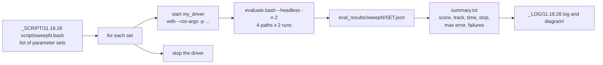

# Data flow

How data moves between the simulator, my driver and the evaluation scripts. For how the driver decides, see
[ARCHITECTURE.md](ARCHITECTURE.md).

## 1. The big picture

## 2. Topics

| Topic | Type | From -> to | Rate | QoS | Content |
|---|---|---|---|---|---|
| `/path` | `RefPath` | sim_ctrl -> driver | once per run (and empty when idle) | reliable, **transient-local**, depth 1 | ordered nodes (x, y) + `finish_index` |
| `/reset` | `std_msgs/Empty` | sim_ctrl -> vehicle_sim and driver | once per run | reliable, volatile, depth 10 | "start a new run" |
| `/veh_state` | `VehState` | vehicle_sim -> driver, sim_ctrl | 50 Hz | reliable, volatile | rear-axle `x`, `y`, `yaw` (map frame) |
| `/veh_actual` | `VehCtrl` | vehicle_sim -> driver | 50 Hz | reliable, volatile | **actual** speed and steering after the actuator loops |
| `/veh_ctrl` | `VehCtrl` | driver -> vehicle_sim | 20 Hz | reliable, volatile | **commanded** `velocity` [m/s], `steer` [rad] |
| `/score` | `Float64` | sim_ctrl -> consumers | once per run | reliable | total score 0 to 100 |
| `/sim_status` | `String` (JSON) | sim_ctrl -> consumers | once per run | reliable | tracking, time, stop, errors, result |

Why `/path` is transient-local: it is sent once, so the topic keeps the last message and a driver that starts late
still receives it. My subscription must use the same QoS or it never gets the path.

## 3. One run, in time order

`/reset` and `/path` can arrive in **either order**, so the driver never wipes the path on reset: `on_reset()`
clears only the pose, the actual speed and the progress.

## 4. Inside the driver, per message

Callbacks only **store** data. All decisions happen in the timer, so the command rate is steady whatever the
message rates are.

## 5. Inside the simulator: command to motion

This is why the car does not obey commands instantly: the actual speed and steering **lag** the command. At the
finish, the driver commands 0 but the car was still moving at 3.7 m/s one second later. The driver plans its braking
early for exactly this reason.

## 6. How a run is scored

Any result other than `stopped` (`off_track`, `overrun`, `timeout`) gives **0** for time and stop.

## 7. The tuning pipeline

Used for the four rounds: 6 + 6 + 2 + 3 parameter sets, 2 runs per path each.

## 8. Timing

| Item | Rate or delay |
|---|---|
| Physics integration | 100 Hz |
| `/veh_state`, `/veh_actual` | 50 Hz (20 ms) |
| Driver control loop and `/veh_ctrl` | 20 Hz (50 ms) |
| Command timeout | 0.5 s without `/veh_ctrl` -> speed target 0 |
| Speed loop lag | about 1 to 2 s to settle (PI loop, natural frequency 3 rad/s, damping 0.8) |
| Steering rate limit | 1 rad/s |
| Run time limit | 60 s |

The pose the driver reads can be up to 20 ms old, and the next command only changes the car through the actuator loops.
At 25 m/s the car travels 0.5 m in 20 ms, so the driver always acts on slightly old information. This is one reason a
longer lookahead helps at speed.

## 9. Ordering pitfalls

- **`/path` and `/reset` order is not guaranteed.** Keep the path on reset.
- **A late-started driver** only gets the path if it uses transient-local QoS.
- **Empty `/path` means "no task":** publish zero speed; do not keep following the last path.
- **Stop publishing and the car stops:** the 0.5 s timeout is a safety feature, not a bug.
- **Only one driver at a time** may publish `/veh_ctrl`, otherwise the two commands compete.
